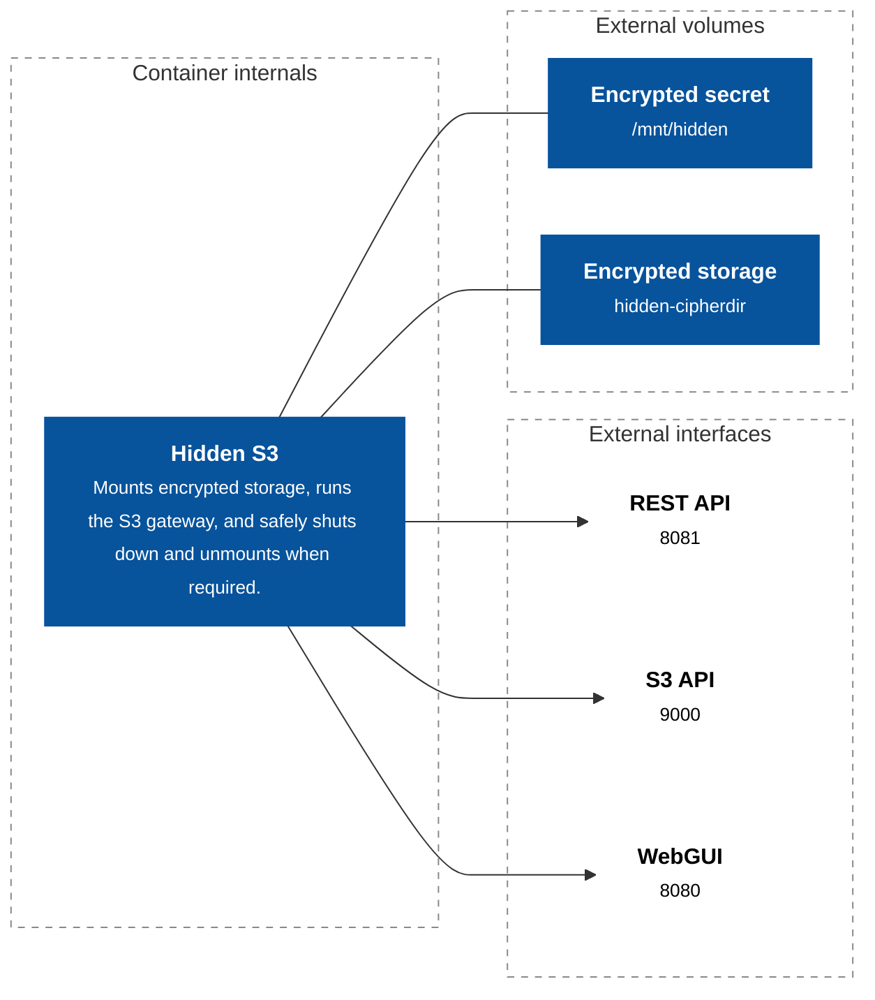

# Hidden S3 — encrypted self-hosted S3 storage

This is S3-compatible object storage for sensitive data on privately
managed infrastructure. It provides filesystem-level encryption
independently of the S3 layer while maintaining full S3 compatibility.

Built on `gocryptfs` and `VersityGW`, the system combines encrypted
storage with an S3-compatible gateway. `VersityGW` provides the S3 API,
IAM, and WebGUI, while `FastAPI` manages the storage lifecycle through
an OpenAPI interface.

It runs as a `Docker` container with persistent state stored in two
volumes: `cipherdir` for encrypted data and a bind-mounted `secrets`
volume for internal secrets. The `secrets` volume can reside on
removable media or a separate remote host.

The `cipherdir` is mounted through `gocryptfs` using an encrypted
passphrase stored in `secrets` and unlocked with a `master password`.
When unmounted, the data remains encrypted and inaccessible.

The encrypted filesystem uses a `POSIX` layout, storing S3 objects as
regular files and directories together with IAM data. This allows files
and directories to be transferred directly into or out of the storage
without conversion.

For emergency recovery, the `cipherdir` can be mounted directly with
`gocryptfs` using the decrypted passphrase. The data is not locked into
the application and can be accessed or exported independently.


[](./LICENSE)

If you like it, star it ⭐ — it helps discoverability. Thank you!

## References

- Encrypted filesystem: [gocryptfs](https://github.com/rfjakob/gocryptfs)
- S3-compatible gateway: [VersityGW](https://github.com/versity/versitygw)
- Architectural decisions: [ADR.md](./ADR.md)

## Quick start

Mount remote storage or removable media at `/mnt/hidden/secrets` to
store the application secrets, then build and run the container:

```sh
make install
```

Or, use force mode in a trusted environment (the `/mnt/hidden/secrets`
path will be created automatically as a local directory on the host
filesystem):

```sh
make install FORCE=1
```

By default, the management interface is exposed on port `8081`. Use it
to initialize and mount the encrypted storage and manage its state:

[http://localhost:8081/docs](http://localhost:8081/docs)

Once the storage is mounted, the S3 API is available on port `9000` and
the WebGUI on port `8080`:

[http://localhost:8080](http://localhost:8080)

That's it — use your preferred S3-compatible client or the WebGUI.

## How it works

S3 data and IAM state reside within the encrypted filesystem. Decrypted
data is available only while the filesystem is mounted and is accessible
externally only through the S3 API.

Initialization, mounting, unmounting, and other operations on the
encrypted storage require both the `secrets` volume to be available and
the `master password` to be provided. If either is unavailable, the
storage remains protected.

As an additional protection layer, a `watchdog` monitors critical
runtime conditions. If the application process fails, the `secrets`
volume becomes unavailable, or the storage itself becomes inaccessible,
it automatically unmounts the decrypted filesystem and stops the S3
gateway.



## Use cases

The project is designed for scenarios where data must remain protected
independently of the storage service and underlying infrastructure.
Typical use cases include:

- **Private storage** — storage for sensitive data where encryption and
access to decrypted contents remain under the owner's control.

- **Internal storage** — S3-compatible storage for applications, services,
and teams running on privately managed infrastructure.

- **Isolated environments** — local S3 storage for disconnected,
restricted, or otherwise self-contained infrastructure.

- **Backup and archival storage** — encrypted S3 storage for backups,
snapshots, exports, and long-term data retention.

## What is protected

The protection model covers physical access to stored data, storage
volumes, or the host system. Encryption remains independent of the S3
layer and application-level access controls.

- **Stolen host or unauthorized disk access.** The `cipherdir` contains
encrypted data only. Physical access to the host or storage, raw disk
access, filesystem recovery tools, or direct inspection of the encrypted
volume do not expose plaintext file contents or names.

- **Leaked volume data.** The `cipherdir` and `secrets` volumes are
protected independently. A copied or exposed `cipherdir` remains
encrypted without the corresponding `gocryptfs` passphrase, while the
passphrase stored in `secrets` is itself encrypted and cannot be used
without the `master password`. Even possession of both volumes is
insufficient to access the stored data without the `master password`.

- **Unexpected runtime conditions.** A `watchdog` monitors the
application process, the `secrets` volume, and the encrypted storage.
If a critical condition is detected, it unmounts the decrypted
filesystem and stops the S3 gateway.

- **Container loss or replacement.** Persistent data and secrets are
stored outside the application container, allowing the container to be
replaced without affecting the stored data. The `cipherdir` can also be
mounted directly with `gocryptfs` using the decrypted passphrase,
providing access to its POSIX files and directories independently
of the application.

## What is not protected against

The protection model does not cover compromised runtime environments
or recovery from a lost master password.

- **Runtime host or container compromise.** While the encrypted
filesystem is mounted, decrypted data exists inside the container.
An attacker with sufficient privileges on the host or inside the
container may be able to access the decrypted filesystem directly.

- **Forgotten master password.** The `master password` is not stored
anywhere. If lost, the encrypted passphrase cannot be unlocked and the
storage cannot be recovered.

- **Unsecured network access.** The application does not encrypt network
traffic. `TLS` must be configured at the infrastructure level. Without
it, an attacker with access to the trusted network may intercept
sensitive information transmitted over the network.

## License

This project is licensed under the **Apache License 2.0**
(`Apache-2.0`).

You may use, modify, and distribute this software in accordance with
the terms of the Apache License 2.0.

See [LICENSE](./LICENSE) for the full license text.
