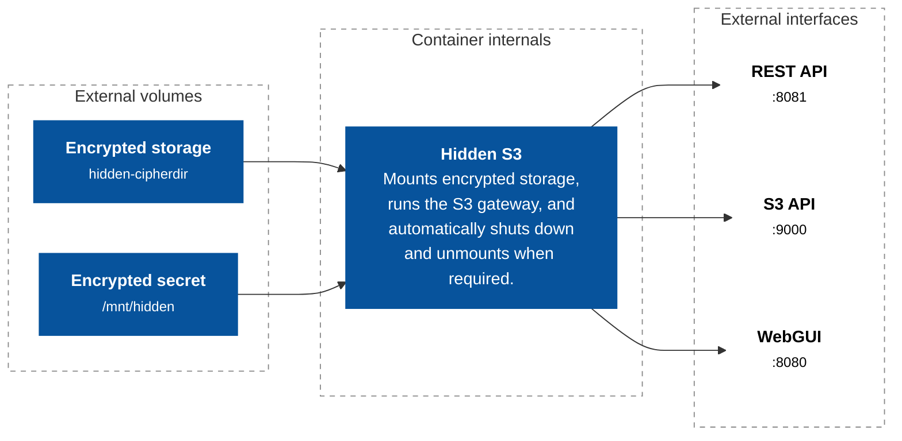
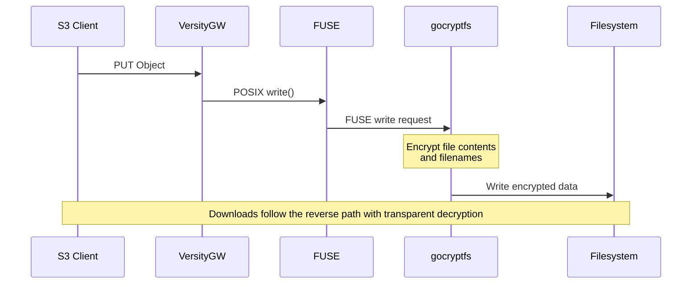

# Hidden S3 — encrypted self-hosted S3 storage

This is S3-compatible object storage for sensitive data on privately
managed infrastructure. It provides filesystem-level encryption
independently of the S3 layer while maintaining full S3 compatibility.

Built on `gocryptfs` and `VersityGW`, the system combines encrypted
storage with an S3-compatible gateway. `VersityGW` provides the S3 API,
IAM, and WebGUI, while `FastAPI` manages the storage lifecycle through
an OpenAPI interface.

It runs as a `Docker` container with persistent state stored in two
volumes: `cipherdir` for encrypted data and a bind-mounted `secrets`
volume for internal secrets. The `secrets` volume can reside on
removable media or a separate remote host.

The `cipherdir` is mounted through `gocryptfs` using an encrypted
passphrase stored in `secrets` and unlocked with a `master password`.
When unmounted, the data remains encrypted and inaccessible.

The encrypted filesystem uses a `POSIX` layout, storing S3 objects as
regular files and directories together with IAM data. This allows files
and directories to be transferred directly into or out of the storage
without conversion.

For emergency recovery, the `cipherdir` can be mounted directly with
`gocryptfs` using the decrypted passphrase. The data is not locked into
the application and can be accessed or exported independently.


[](./LICENSE)

If you like it, star it ⭐ — it helps discoverability. Thank you!

## References

- Encrypted filesystem: [gocryptfs](https://github.com/rfjakob/gocryptfs)
- S3-compatible gateway: [VersityGW](https://github.com/versity/versitygw)
- Architectural decisions: [ADR.md](./ADR.md)
- Compatible software: [ECOSYSTEM.md](./ECOSYSTEM.md)

## Requirements

- Linux host with Docker and FUSE support.
- Docker permissions required for FUSE mounts.
- Shared mount propagation for external secrets storage.
- GNU Make for installation using the provided Makefile.

## Quick start

Mount remote storage or removable media at `/mnt/hidden/secrets` to
store the application secrets, then build and run the container:

```sh
make install
```

Or, use force mode in a trusted environment (the `/mnt/hidden/secrets`
path will be created automatically as a local directory on the host
filesystem):

```sh
make install FORCE=1
```

By default, the management interface is exposed on port `8081`. Use it
to initialize and mount the encrypted storage and manage its state:

[http://localhost:8081/docs](http://localhost:8081/docs)

Once the storage is mounted, the S3 API is available on port `9000` and
the WebGUI on port `8080`:

[http://localhost:8080](http://localhost:8080)

That's it — use your preferred S3-compatible client or the WebGUI.

## How it works

S3 data and IAM state reside within the encrypted filesystem. Decrypted
data is available only while the filesystem is mounted and is accessible
externally only through the S3 gateway.

Initialization, mounting, manual unmounting, and other operations on the
encrypted storage require both the `secrets` volume to be available and
the `master password` to be provided. If either is unavailable, the
storage remains protected.



When an object is uploaded through the S3 API, `VersityGW` writes it to
the mounted filesystem using standard POSIX operations. These operations
pass through `FUSE` to `gocryptfs`, which transparently encrypts file
contents and filenames before storing them on the underlying filesystem.
Downloads follow the same path in reverse, with data decrypted on the fly.



As an additional protection layer, a `watchdog` monitors critical
runtime conditions. If the application process fails, the `secrets`
volume becomes unavailable, or the storage itself becomes inaccessible,
it automatically unmounts the decrypted filesystem and stops the S3
gateway.

## What is protected

The protection model covers physical access to stored data, storage
volumes, or the host system. Encryption remains independent of the S3
layer and application-level access controls.

- **Stolen host or unauthorized disk access.** The `cipherdir` contains
encrypted data only. Physical access to the host or storage, raw disk
access, filesystem recovery tools, or direct inspection of the encrypted
volume do not expose plaintext file contents or names.

- **Leaked volume data.** The `cipherdir` and `secrets` volumes are
protected independently. A copied or exposed `cipherdir` remains
encrypted without the corresponding `gocryptfs` passphrase, while the
passphrase stored in `secrets` is itself encrypted and cannot be used
without the `master password`. Even possession of both volumes is
insufficient to access the stored data without the `master password`.

- **Unexpected runtime conditions.** A `watchdog` monitors the
application process, the `secrets` volume, and the encrypted storage.
If a critical condition is detected, it unmounts the decrypted
filesystem and stops the S3 gateway.

- **Container loss or replacement.** Persistent data and secrets are
stored outside the application container, allowing the container to be
replaced without affecting the stored data. The `cipherdir` can also be
mounted directly with `gocryptfs` using the decrypted passphrase,
providing access to its POSIX files and directories independently
of the application.

## What is not protected against

The protection model does not cover compromised runtime environments
or recovery from a lost master password.

- **Runtime host or container compromise.** While the encrypted
filesystem is mounted, decrypted data exists inside the container.
An attacker with sufficient privileges on the host or inside the
container may be able to access the decrypted filesystem directly.

- **Forgotten master password.** The `master password` is not stored
anywhere. If lost, the encrypted passphrase cannot be unlocked and the
storage cannot be recovered.

- **Unsecured network access.** TLS is disabled by default. It can be
enabled for the S3 API and WebGUI with a certificate and private key.
The management API still needs TLS at the infrastructure level. Without
TLS, network traffic is not protected in transit.

## Security audit

The project uses three security analysis tools:

- **Bandit** — scans Python source code for potential security issues.
- **Semgrep** — performs static analysis using Python and security audit rules.
- **pip-audit** — checks Python dependencies for known vulnerabilities.

Run all checks against the running container:

```sh
make audit
```

The audit tools are installed inside the container when invoked.

## How to enable TLS for S3 and WebGUI

To enable TLS for both the S3 API and WebGUI, place a PEM certificate
and private key in the project before running `make install`:

```sh
cp /path/to/fullchain.pem ./cert.pem
cp /path/to/private-key.pem ./key.pem
```

Configure their paths and the WebGUI URLs in `.env` (leave `localhost`
when opening the WebGUI at `https://localhost:8080`; otherwise use the
certificate hostname in both URLs and open the WebGUI at that hostname):

```dotenv
VGW_CERT=/opt/hidden/cert.pem
VGW_KEY=/opt/hidden/key.pem
VERSITY_WEBGUI_GATEWAY=https://localhost:9000
VERSITY_WEBGUI_CORS_ALLOW_ORIGIN=https://localhost:8080
```

Then build and run the container:

```sh
make install
```

Because the private key is copied into the Docker image, keep the image
and build context private. For shared images, terminate TLS externally
or mount the certificate and key at runtime instead.

## License

This project is licensed under the **Apache License 2.0**, allowing use,
modification, and distribution in accordance with its terms.

See [LICENSE](./LICENSE) for details.
